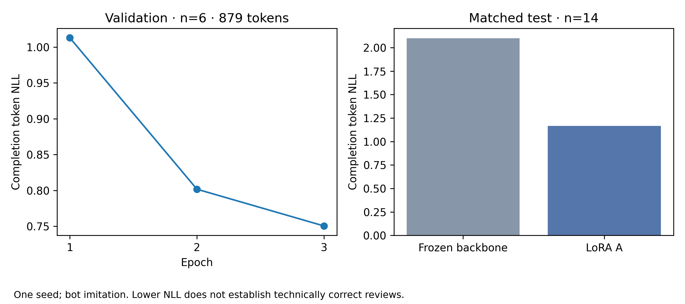

# Corrida A · 2026-10-14

Qwen/Qwen3.5-4B textual, LoRA A: 61 ejemplos de entrenamiento, 6 de validación,
14 de test. Tres épocas, 48 updates más un smoke de un update; semilla 42.
El presupuesto medido desde preflight hasta evaluación fue 24,01 minutos,
por debajo de seis horas. La ejecución usó la revisión de código
`931b8830d717df22d1e01d2e04a8bd018615ec6e` y el modelo base
`851bf6e806efd8d0a36b00ddf55e13ccb7b8cd0a`.

[Notebook ejecutado](https://molab.marimo.io/notebooks/nb_uC9naRgb2fSGXao1rhxvNP).

| Medición | Backbone | A |
|---|---:|---:|
| NLL test BF16, 2396 tokens | 2,0774 | 1,1291 |
| NLL test NF4, mismos 2396 tokens | 2,1004 | 1,1671 |

El checkpoint se seleccionó por validación: NLL por época 1,0129, 0,8018,
0,7505. La recarga en una instancia nueva y generación NF4 se observaron en
Molab. Las 14 salidas de test fueron arrays JSON parseables; esto no valida
su esquema completo, sus ubicaciones ni la corrección de sus comentarios.

La latencia mediana fue 5,24 s por generación en RTX Pro 6000, para entradas
de 2345–3797 tokens y respuestas de 109–174 tokens. El pico de memoria CUDA
asignada fue 3,965 GiB. La memoria reservada llegó a 14,842 GiB y conserva
asignaciones de evaluaciones anteriores; no equivale al mínimo necesario
para generación. El uso total del dispositivo y el despliegue en RTX 2050
de 4 GB permanecen sin verificar.



Solo hay supervisión positiva de bots y una semilla. El test es pequeño y no
tiene etiquetas humanas de calidad. No se evaluaron todavía las ablaciones
de grafo/RAG ni la utilidad técnica. B y su cabeza permanecen sin entrenar.

La copia local verificada está en `artifacts/run-A-20261014-232326.zip`,
excluida de Git, con adaptadores, tokenizer, referencias del backbone,
predicciones, historia y manifiestos. Los 37 archivos originales verificaron;
el checkpoint seleccionado y el smoke tienen manifiestos válidos. Los tensores
de A son finitos y cambiaron los 64; los 64 de B y su cabeza no cambiaron.
Se reparó únicamente el manifiesto auxiliar de `latest/resume.pt`, generado
antes de escribir el estado del optimizador. La descarga original se preservó.
La copia corregida registra el cambio en `execution-evidence.json`.

La procedencia original conserva `runtime.code_revision=null` porque se instaló
como paquete; el SHA de código citado arriba procede de la sesión observada.
La cuota física de almacenamiento no se deduce del `disk_free_bytes` virtual.

Para reproducir el entrenamiento, usar el corpus congelado y el notebook,
con un nuevo presupuesto autorizado. Para regenerar estas figuras sin entrenar:

```sh
python scripts/report_training.py artifacts/run-A-20261014-232326
```

Para cargar A mediante Python, instalar las dependencias fijadas y construir
`SharedReviewer(load_base("qwen35", revision, local_only=False), tokenizer,
"qwen35", revision)`, con tokenizer de `checkpoint/tokenizer`. Verificar
`config.json["A_trained"]` y restaurar con `require_trained=False`, pues la
marca del revisor completo continúa siendo falsa mientras B no esté entrenada.
Tokenizar contexto de un hunk sin etiquetas con `coder.model.tokenize` y usar
`reviewer.generate`; no utilizar la salida B aleatoria para riesgo o calidad.
